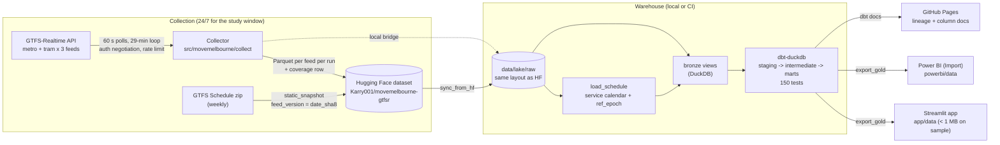

# Architecture



## Components

| Path | Responsibility |
|---|---|
| `src/movemelbourne/collect/` | `client.py` (auth negotiation, rate limit, retries, redaction), `parse.py` (protobuf → fixed schema + `extra_json`), `run_collection.py` (poll loop, run output, coverage), `upload.py` (one HF commit per run) |
| `src/movemelbourne/ingest/` | `static_snapshot.py` (streamed download, SHA-256 versioning, nested-zip extraction, all-string Parquet), `load_schedule.py` (service calendar + DST-correct `ref_epoch`, validation report) |
| `src/movemelbourne/load/` | `sync_from_hf.py` (incremental dataset sync into the lake), `bronze.py` (DuckDB views, typed empty views for missing sources) |
| `src/movemelbourne/analysis/` | `bootstrap.py` (trip-clustered bootstrap CI) |
| `dbt/` | Kimball star schema; see the DAG on the docs site |
| `scripts/` | `probe_feeds.py`, `run_pipeline.py`, `export_gold.py`, `make_sample.py`, `collector_status.py`, local collector PowerShell scripts |
| `app/` | Streamlit dashboard (8 pages), reads only `app/data` |
| `powerbi/` | Semantic model, DAX, page spec, theme (the `.pbix` is built by hand) |

## dbt model layers

```
staging (views)          intermediate (tables)                     marts (tables)
stg_rt_trip_updates  ─┐  int_rt_polls ─ int_collection_sessions     dim_date  dim_time_band  dim_mode
stg_rt_vehicle_pos.  ─┤  int_feed_version_in_force                  dim_route dim_stop dim_trip dim_feed_version
stg_rt_service_alerts ┤  int_scheduled_stop_events/_trips           fact_stop_event (incremental)
stg_rt_coverage      ─┤  int_rt_trip_polls ─ int_rt_trip_presence   fact_trip  fact_alert  audit_outliers
stg_gtfs_* (7)       ─┤  int_rt_stop_predictions_dedup              agg_otp_daily_mode / _daily_route / _route
stg_service_calendar ─┘  int_observed_stop_events (last prediction) agg_otp_stop / _hour_dow
                         int_vp_stop_arrivals (vehicle positions)   agg_segment_delay  agg_headway_adherence
                         int_stop_events_matched ─ int_trip_outcomes agg_coverage_daily agg_inference_agreement
                         int_rt_unmatched_trips  int_headways        agg_disruption_otp
```

## Tests (zero failures on main)

- **Python (pytest, 44):** auth negotiation and redaction, protobuf parsing (incl. cancelled trips,
  multi-period alerts, schema drift), collector loop and run layout, GTFS > 24:00 and both DST
  changes, calendar exceptions, lake publishing, bronze views, bootstrap CI.
- **dbt (150 nodes on the sample):** unique/not-null keys on every fact grain; relationships from
  facts to every dimension; accepted values for modes, directions, schedule relationships, match
  status, delay bands; delay range on OTP-eligible events; 0–100 bounds on percentages; singular
  tests for trip match rate ≥ 95%, observed ≤ scheduled, no missing collection days, monotonic
  scheduled times, and "unobserved never carries a delay"; one unit test on the versioned
  timetable rule.
- **CI:** ruff, pytest, full `dbt build` on the committed sample, gitleaks. No API key needed.

## Workflows

| Workflow | Trigger | Does |
|---|---|---|
| `collect.yml` | every 30 min | 29-min poll loop → HF; artifact fallback on upload failure |
| `static_snapshot.yml` | Mondays 03:17 UTC | new timetable version → HF; logs it in `docs/feed_versions.md` (keeps the repo active) |
| `coverage_check.yml` | daily 09:17 AEDT | opens or updates a `collector-health` issue on gaps > 2 h, stalled collection or < 90% poll success |
| `ci.yml` | PR / push | lint, tests, sample `dbt build`, secret scan |
| `dbt_docs.yml` | push to main (dbt changes) | dbt docs → GitHub Pages |

## DuckDB-specific SQL (portability notes)

`arg_max` / `arg_min` / `max_by` / `min_by`, `ASOF LEFT JOIN`, `quantile_cont`, `QUALIFY`,
`AT TIME ZONE` via ICU, and `read_parquet(... union_by_name, hive_partitioning)` in bronze. Each has
a direct equivalent in Snowflake or BigQuery (`MAX_BY`, window-function as-of joins,
`PERCENTILE_CONT`, `QUALIFY`, `CONVERT_TIMEZONE`, external tables).
