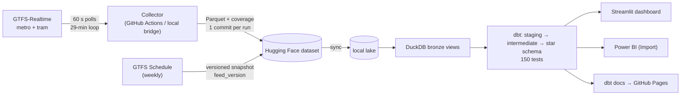

# MoveMelbourne

**How reliable are Melbourne's trains and trams? An independent measurement from four weeks of
self-collected live data.**

Victoria's GTFS-Realtime feeds disappear the moment they are served, and there is no public
archive. MoveMelbourne collects them every minute, joins them to the timetable that was actually
in force each day, infers when each train and tram really arrived, and publishes on-time
performance, delay distributions, reliability, delay hotspots and tram bunching. Every figure
comes with its coverage and sample size.

> **Status (21 Oct 2026):** pipeline, warehouse, tests, dashboard and docs are built. The live
> feeds have been probed and a first 6-minute live run went end to end (Hugging Face upload,
> warehouse build, 100% trip match rate). **The 28-day collection study has not started yet**, so
> there are no findings. The dashboard currently shows a **synthetic sample**, labelled as such.
> What the live feeds actually do: [docs/feed_behaviour.md](docs/feed_behaviour.md).

| | Link |
|---|---|
| 📊 Dashboard (Streamlit) | `<STREAMLIT_URL>` (MANUAL: deploy) |
| 🗃️ Collected data (Hugging Face) | `https://huggingface.co/datasets/Karry001/movemelbourne-gtfsr` (MANUAL: create) |
| 🧬 dbt docs and lineage | `https://karthikreddy-tanigundala.github.io/movemelbourne/` (after first push + Pages enabled) |
| 📄 Study report | [docs/STUDY_REPORT.md](docs/STUDY_REPORT.md) (after the study) |

<!-- MANUAL: record docs/images/demo.gif and uncomment

-->
*Demo GIF: to be recorded (MANUAL). The delay-map image is generated after real data exists.*

## Headline findings

*None yet.* They will be filled from committed model outputs only, each paired with coverage:
proxy OTP vs target per mode, reliability, P50/P90 delay, the least reliable routes by
confidence-interval lower bound, the segments that add the most delay, peak vs off-peak, Melbourne
Cup Day, tram bunching, and the gap to official figures.

## Architecture



Details: [ARCHITECTURE.md](ARCHITECTURE.md) · design decisions: [docs/adr](docs/adr)

## Quickstart (5 minutes, no API key)

Python 3.12 and [uv](https://docs.astral.sh/uv/) required.

```bash
git clone https://github.com/KarthikReddy-Tanigundala/movemelbourne && cd movemelbourne
```
```bash
uv sync
```
```bash
uv run python scripts/run_sample.py
```

This builds the DuckDB warehouse and all dbt models and tests on the committed sample (a real
timetable slice plus **synthetic** realtime polls, see [tests/sample](tests/sample/README.md)),
exports the gold tables and opens the dashboard.

## Full reproduction

1. **API key.** Register at the [Transport Victoria Open Data Portal](https://opendata.transport.vic.gov.au/user/login),
   copy `.env.example` to `.env` and set `TVOD_API_KEY` (plus `HF_TOKEN` to publish snapshots).
2. **Probe the feeds** (auth method, field population, saves test fixtures):
   ```bash
   uv run python scripts/probe_feeds.py
   ```
3. **Collect.** Either push the repo and add the `TVOD_API_KEY` / `HF_TOKEN` Actions secrets
   (`collect.yml` runs every 30 min), or run the local bridge on Windows:
   ```bash
   .\scripts\register_local_collector.ps1
   ```
   Check health at any time:
   ```bash
   uv run python scripts/collector_status.py
   ```
4. **Timetable snapshot** (also weekly in Actions):
   ```bash
   uv run python -m movemelbourne.ingest.static_snapshot
   ```
5. **Build:** sync from Hugging Face (or use your local lake), then build and export:
   ```bash
   uv run python -m movemelbourne.load.sync_from_hf
   ```
   ```bash
   uv run python scripts/run_pipeline.py
   ```
   ```bash
   uv run python scripts/export_gold.py
   ```

## Data model

Kimball star schema in dbt-on-DuckDB ([DATA_DICTIONARY.md](DATA_DICTIONARY.md), generated from dbt):

- **Facts:** `fact_stop_event` (service date × trip × stop; incremental), `fact_trip`, `fact_alert`
- **Dimensions:** `dim_date` (VIC holidays, day type), `dim_time_band`, `dim_mode` (on-time
  definitions + targets), `dim_route`, `dim_stop` (WKT geometry), `dim_trip`, `dim_feed_version`
- **Marts:** OTP by day/route/stop/hour, segment delay, headway adherence, coverage, inference
  agreement, disruption impact, outlier audit

## Method in brief

- **Observed arrivals are inferred.** The feeds publish predictions, so an arrival is the latest
  prediction captured within 2 minutes of the vehicle reaching the stop, cross-checked against
  vehicle positions. Unobserved stops are never imputed ([ADR-004](docs/adr/ADR-004-observed-arrival-inference.md)).
- **Versioned timetable join.** Each day is matched to the timetable release in force that day,
  with GTFS times past midnight and daylight saving handled exactly ([ADR-005](docs/adr/ADR-005-versioned-timetable-join.md)).
- **Proxy OTP** uses the official windows (metro ≤ 4:59 late; tram −0:59 / +4:59) at every observed
  stop, and is labelled "proxy" everywhere ([ADR-007](docs/adr/ADR-007-proxy-otp-definition.md)).
- **Distributions, not averages.** P50/P90/P95 delay; cells under 30 events are greyed out;
  routes are ranked by the lower bound of a trip-clustered bootstrap CI.

Full detail: [METHODOLOGY.md](METHODOLOGY.md) · validation plan: [docs/validation.md](docs/validation.md)

## Demo status and persistence

- **Study window:** not started (dates go in `config/study.yaml` and here when collection begins).
- **Dashboard:** shows a fixed study, not live data. A banner and `manifest.json` say which data it
  shows (synthetic sample or study window). The optional "Live now" page shows current vehicle
  positions when an API key is configured.
- **After the study:** collection stops or continues (decision recorded here). GitHub disables
  schedules after 60 days without repo activity; the weekly timetable job's commit prevents that.

## Limitations

- Proxy metric, not the official punctuality measure.
- The metro trip-updates feed excludes replacement buses, service deviations (skipped stops,
  diversions) and platform information.
- Arrival times are inferred from 60-second snapshots; method agreement is published.
- Metro realtime times are whole minutes, which quantises metro delays around the 4:59 threshold.
- Coverage gaps (API outages, GitHub Actions scheduling jitter, restarts) are measured and count
  against coverage, never towards OTP.
- Only trips flagged `CANCELED` count as cancelled; "no data" trips are reported separately.

## Testing and quality

- `uv run pytest`: 50 tests, including parsing of real captured payloads (auth negotiation and redaction, protobuf parsing, collector
  loop, GTFS time and DST rules, calendar, lake, bronze, bootstrap)
- `uv run python scripts/run_pipeline.py --sample`: 150 dbt nodes, including match-rate,
  reconciliation, monotonic-schedule and "unobserved never has a delay" tests and a unit test of
  the versioned-timetable rule
- CI on every PR: ruff, pytest, sample `dbt build`, gitleaks. Pre-commit: ruff, detect-secrets,
  gitleaks

## MANUAL checklist (Karthik)

- [ ] Register the Transport Victoria Open Data account; put `TVOD_API_KEY` in `.env`
- [ ] Create the HF dataset `Karry001/movemelbourne-gtfsr` (public, CC BY 4.0 card) and a write token
- [ ] Run the probe; register the local collector task; record the study start in `config/study.yaml`
- [ ] Push to GitHub; add Actions secrets `TVOD_API_KEY`, `HF_TOKEN`; enable Pages (source: Actions)
- [ ] Deploy `app/streamlit_app.py` on Streamlit Community Cloud (Python 3.12; optional secret `TVOD_API_KEY`)
- [ ] Build the Power BI report from [powerbi/](powerbi/SEMANTIC_MODEL.md); screenshots to `docs/images/`
- [ ] Record `docs/images/demo.gif`
- [ ] After ≥ 14 (target 28) days: write the study report and validation from real outputs

## Part of a wider portfolio

| Project | Domain | Stack signal |
|---|---|---|
| [LittleVitals](<LITTLEVITALS_URL>) | Health-system BI | Snowflake · dbt · Power BI · RLS |
| [AusPolicyRAG](<AUSPOLICYRAG_URL>) | GenAI / RAG | LangChain · ChromaDB · hybrid retrieval · RAGAS |
| [GridCast](<GRIDCAST_URL>) | Time-series forecasting | nemosis · mlforecast · conformal intervals |
| [FootyForecast](<FOOTYFORECAST_URL>) | Sports ML | Elo · XGBoost · clustering · SHAP |
| **MoveMelbourne** | **Data engineering** | **GTFS-RT · DuckDB · dbt · geospatial** |

Profile: [github.com/KarthikReddy-Tanigundala](https://github.com/KarthikReddy-Tanigundala)

## Data sources and licence

Contains data from the **Department of Transport and Planning** (GTFS Schedule and GTFS
Realtime), licensed under [Creative Commons Attribution 4.0](https://creativecommons.org/licenses/by/4.0/).
MoveMelbourne figures are independent proxy estimates, not official performance results. Source
list: [docs/sources.md](docs/sources.md). Code: [MIT](LICENSE).

## About

Built by Karthik Reddy Tanigundala (Master of Data Science, RMIT) to production standard as the
data-engineering project of a five-project Melbourne data portfolio.
